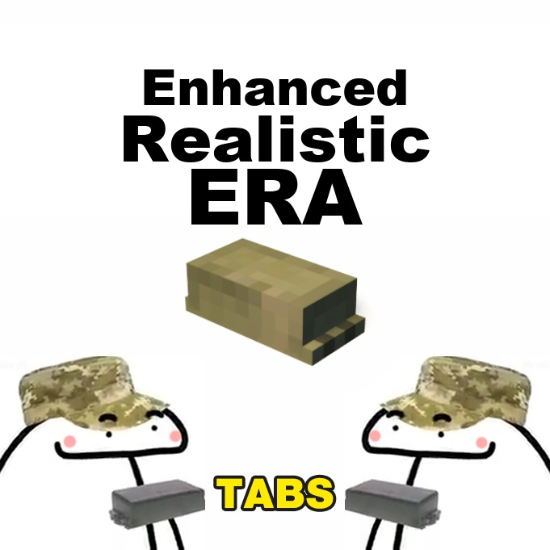

# Enhanced Realistic ERA

A fan update of Okidoki's **Realistic ERA** for Teardown — manually placeable explosive reactive armor for [TABS] vehicles (Kontakt-1/5, Relikt, Relikt Bag, TUSK, BUSK, Nozh, Karkas), plus **one-key auto-cover**.

## Why this exists

Hand-placing ERA one block at a time is fine for a single turret cheek, but covering a whole tank takes dozens of clicks — and doing it again for every vehicle in a TABS-TAK battle is exhausting.

**Auto-cover:** aim at an armor face and press **X** — the whole connected panel is tiled automatically with the selected ERA type, block by block, following the surface. Blocks land with the same orientation, jointing and settings as manual placement. Cells that already carry ERA are skipped (max 80 blocks per press).

## Controls (rebindable in mod settings)

| Key | Action |
|-----|--------|
| LMB | Place ERA block |
| G | Switch ERA type |
| E | Switch Green / Desert |
| R | Rotation mode on/off (+ mouse wheel, RMB switches axis, MMB resets) |
| X | Auto-cover aimed surface |

## Install

- **Steam Workshop:** link coming soon (requires **[TABS] Vehicle Framework** for the ballistics to matter).
- **Manual:** copy this folder to `Documents/Teardown/mods/`.

## Credits

- Original **Realistic ERA** by [Okidoki](https://steamcommunity.com/sharedfiles/filedetails/?id=3426012993) — all ERA types, ballistics/fragment simulation, manual tool.
- Auto-cover update by Andrew.

## License

MIT — see [LICENSE](LICENSE). The original mod's assets remain the work of their author and are included here with credit; if you are the original author and want anything changed, open an issue.
